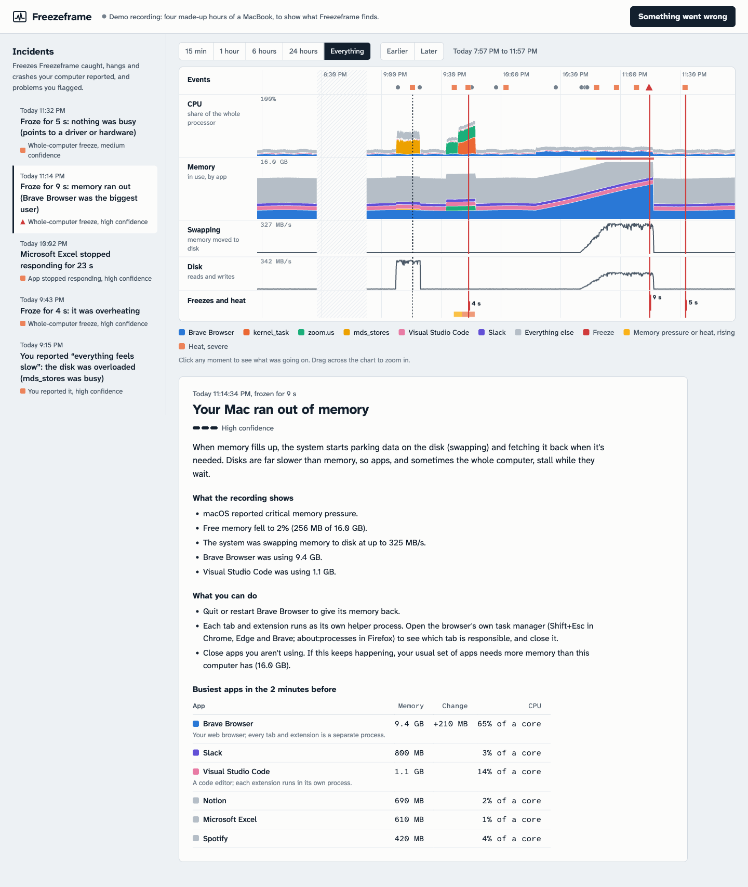
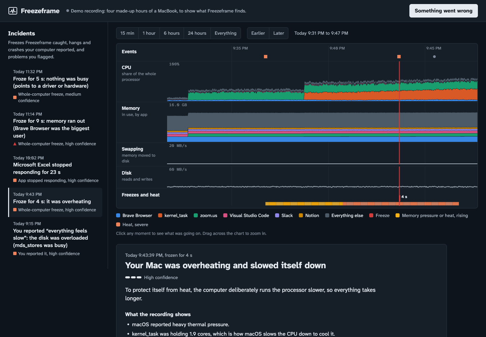

# Freezeframe

**A flight recorder for your computer.** It quietly keeps the last couple of days of what every app was doing, notices freezes on its own, and when something goes wrong it tells you why, in plain English.



## Why

Your laptop locks up for ten seconds. By the time you open Activity Monitor or Task Manager, everything looks normal, because those tools only show *right now*. The evidence is gone. The tools that do keep history are built for experts: Console and Event Viewer are walls of log lines, Reliability Monitor lists crashes with no context, and Performance Monitor needs you to set up a trace *before* the problem happens.

Freezeframe is always recording, so after a freeze you can rewind and ask:

```
$ freezeframe why

Froze for 9 s: memory ran out (Brave Browser was the biggest user)
Today 11:14:11 PM, lasting 9 s

  Your Mac ran out of memory  high confidence
  When memory fills up, the system starts parking data on the disk (swapping) and fetching
  it back when it's needed. Disks are far slower than memory, so apps, and sometimes the
  whole computer, stall while they wait.

  What the recording shows
  - macOS reported critical memory pressure.
  - Free memory fell to 2% (256 MB of 16.0 GB).
  - The system was swapping memory to disk at up to 325 MB/s.
  - Brave Browser was using 9.4 GB.

  What you can do
  1. Quit or restart Brave Browser to give its memory back.
  2. Each tab and extension runs as its own helper process. Open the browser's own task
     manager (Shift+Esc in Chrome, Edge and Brave; about:processes in Firefox) to see which
     tab is responsible, and close it.
  3. Close apps you aren't using. If this keeps happening, your usual set of apps needs
     more memory than this computer has (16.0 GB).
```

In that recording it had also flagged *"Brave Browser has been growing steadily (+5.3 GB per hour); it may be leaking memory"* almost an hour before the freeze.

## What it catches

| Problem | How it's detected |
|---|---|
| The whole computer freezing | A watchdog: the recorder expects to wake every 2 s, so a late wake-up is a freeze. Sleep is told apart by comparing two clocks (see below). |
| An app hanging or crashing | Imports the hang and crash reports macOS and Windows already write but hide away |
| Running out of memory, swapping | OS memory pressure, free memory and swap traffic |
| One app hogging the CPU | Per-app CPU, with helper processes added up under the app's real name |
| Slow memory leaks | A steady climb over the last hour (linear fit with R² ≥ 0.85) |
| An overloaded disk | Read and write throughput; per app on Windows and Linux |
| Overheating and throttling | macOS thermal pressure, and `kernel_task` holding the CPU back |
| Hardware and driver errors | Kernel panics, blue screens, WHEA hardware errors, graphics driver resets, disk errors, unexpected restarts |

Each verdict comes with the numbers behind it, a confidence level, and what to do about it, tailored to Mac, Windows or Linux. When nothing was busy during a freeze, it says so. That's a finding too: a calm machine that still froze points at drivers or hardware, not your apps.



## Install

Requires Python 3.10 or newer. No administrator rights needed.

```bash
pipx install git+https://github.com/atharv146/freezeframe
freezeframe install        # record in the background, starting at login
```

See it in action right away with a demo recording containing five kinds of incidents:

```bash
freezeframe open --demo
```

## Use

| Command | What it does |
|---|---|
| `freezeframe why` | Explains the latest freeze, or the last two minutes if nothing froze |
| `freezeframe why --at 3:42pm` | Explains a moment you choose (`10m`, `15:42` and ISO times work too) |
| `freezeframe mark "zoom froze"` | Notes that something just went wrong and explains the moments before it |
| `freezeframe list` / `show <n>` | Lists incidents / explains one |
| `freezeframe open` | Opens the timeline dashboard in your browser |
| `freezeframe status` | Is it recording, how far back, and how much space it uses |
| `freezeframe uninstall` / `forget --yes` | Stops background recording / deletes the recording |

In the dashboard, click any incident or any moment on the timeline to get an explanation, drag across the chart to zoom, and use **Something went wrong** when you notice a problem.

## How it works

```
 sampler (every 2 s) ──► detectors ──► SQLite recording ◄── OS report importer (every 60 s)
   CPU, memory, swap,      freezes,       samples, per-app      macOS DiagnosticReports,
   disk, heat, per-app     spikes,        usage, events         Windows event logs,
   usage                   leaks                                 Linux kernel journal
                                               │
                                     diagnosis engine ──► CLI and local dashboard
```

- **Freeze detection with two clocks.** The recorder sleeps until its next 2-second tick. If the machine locks up, the recorder can't run either, so it wakes late, and the delay is the freeze length. Sleep also makes it wake late, but the *wall clock* keeps counting during sleep while the *monotonic clock* pauses. During a freeze both keep counting, so comparing them separates "froze for 6 s" from "the lid was closed for an hour".
- **Seeing system processes without admin rights.** On macOS, Python can't read the CPU time of root processes like WindowServer or Spotlight's `mds_stores`, and those matter most. So Freezeframe reads them through `ps`, which can, and computes CPU% from the change in each process's CPU time between samples.
- **Apps, not processes.** Browsers and editors run dozens of helpers. Freezeframe adds them up under the app you recognize, using the outermost `.app` bundle on macOS and a name map on Windows.
- **Diagnosis.** For an incident, it looks at the two minutes before and scores each cause from the evidence: memory, CPU, disk, heat, an app hanging on its own, or a hardware or driver error the OS logged. It also compares against the preceding half hour to call out what's unusual. A knowledge base explains the usual suspects (Spotlight, Time Machine, Windows Defender, Windows Update, `kernel_task`, WindowServer, `dwm.exe` and more) in plain words.
- **Storage.** A local SQLite file of about 40 MB per day. Detailed history is trimmed after 2 days, but the minutes around each incident are kept for 30 days.
- **Overhead.** About 1% of one CPU core on an M-series MacBook (measured: the recorder itself 0.4%, plus the `ps` snapshot).

## Privacy

Everything stays on your computer. Nothing is uploaded. The dashboard listens only on `127.0.0.1` and rejects requests from other websites by checking the `Host` and `Origin` headers.

## Platform support

| | macOS | Windows | Linux |
|---|---|---|---|
| Freeze detection, CPU, memory, swap, disk | ✓ | ✓ | ✓ |
| Per-app disk traffic | needs admin, not used | ✓ | ✓ |
| Memory pressure from the OS | ✓ | low-memory events | out-of-memory kills |
| Heat and throttling | ✓ | not yet | not yet |
| App hangs and crashes | DiagnosticReports | Event Log | – |
| Kernel panics and hardware errors | panic reports | blue screens, WHEA, GPU resets, disk errors | machine checks, GPU hangs, I/O errors |
| Starts at login | launchd agent | Task Scheduler | systemd user service |

## Development

```bash
python -m venv .venv && .venv/bin/pip install -e ".[dev]"
.venv/bin/pytest
```

The tests cover:
- the freeze/sleep classifier and every detector;
- the report parsers, against sample macOS (`.ips`, `.hang`, `.diag`, panic), Windows event-log and Linux journal data;
- storage and pruning;
- a recorder run with a simulated freeze and a simulated sleep;
- each diagnosis scenario in the demo recording;
- the HTTP API, including its cross-site protections;
- the CLI.

CI runs the tests on macOS, Windows and Linux.

## License

MIT
